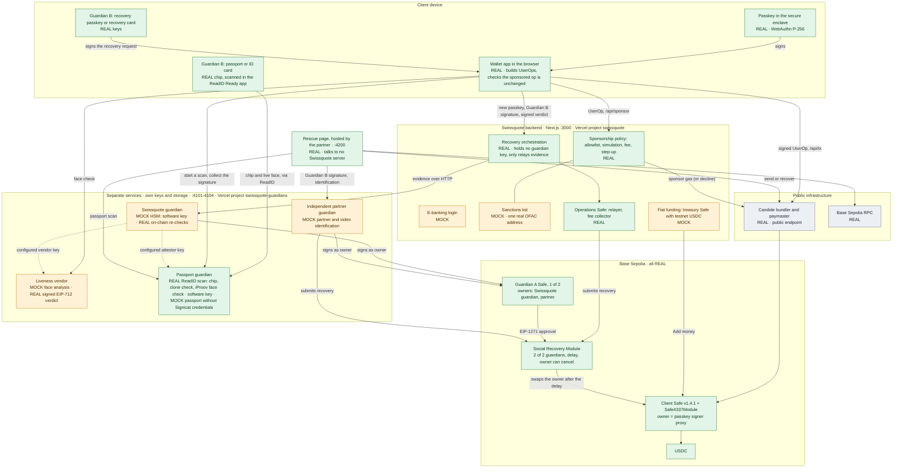

# Swissquote Self-Custody Wallet

Hackathon prototype for the Swissquote Wallet Challenge: a wallet a Swiss bank could launch where **the client is the only one who can move funds**, signing with a passkey (Face ID, Touch ID, Windows Hello or device PIN), while Swissquote helps with recovery and pays gas, without ever gaining control.

- **Proposal and design rationale:** [docs/proposal.html](docs/proposal.html)
- **Design system:** [docs/design.md](docs/design.md), with a preview in [docs/style-tile.html](docs/style-tile.html)
- **Independent reviews of the plan:** [docs/review-codex.md](docs/review-codex.md), [docs/review-claude.md](docs/review-claude.md)
- **App:** [`web/`](web), a Next.js 16 responsive website that works on phones and computers

Live demo: swissquote-two.vercel.app

## What is real and what is mocked

| Real, on Base Sepolia | Mocked, and labelled in the UI |
|---|---|
| WebAuthn passkeys (P-256), verified on-chain for every transaction | Swissquote e-banking login |
| Safe v1.4.1 smart account, Safe4337Module v0.3.0, EntryPoint v0.7 | Face analysis in the liveness check (camera preview, outcome chosen in the demo) |
| Safe WebAuthn signer contracts (one per passkey) | HSMs: each guardian is a **separate service** (`services/guardian-core.ts`) with its own software key and storage: its own process locally, the separate `swissquote-guardians` Vercel project with its own database in production. The web backend never holds a guardian key |
| Candide Social Recovery Module (3-minute testnet deployment; 3-day in production) | Sanctions list (one real OFAC SDN address as the demo entry) |
| Guardian A as a 1-of-2 Safe (Swissquote HSM, independent partner), verified by the module via EIP-1271 | The partner's video identification (outcome chosen in the demo) |
| EIP-712 guardian approvals, EIP-1271 guardian passkey, owner swap, old-key revocation | Fiat funding: a treasury Safe holding testnet USDC stands in for the crypto desk |
| Gas sponsorship (Candide paymaster), bundler, USDC transfers, batched service fee | Push and e-mail channels (the alerts are real; delivery is the in-app inbox and toasts) |
| Simulation: `eth_call` from the wallet plus bundler gas estimation | Per-client trusted contact as Guardian A (designed, not wired into the recovery UI) |
| Ownership proof checked on-chain via EIP-1271 | Passport or ID card scan when the passport guardian has no Signicat credentials: a secret kept in the enrolling browser stands in for the chip (labelled *Simulated passport*) |
| Passport or ID card as Guardian B: a separate passport guardian service signs the recovery request only after a ReadID Ready scan of the enrolled document (chip authenticity, clone check, iProov face check) | Trading account, market prices and the USDC/CHF rate (simulated in the browser, labelled *Simulated*) |

**Liveness is mocked, but its verdict cannot be faked by Swissquote's backend.** The vendor is a separate process with its own key. It signs an EIP-712 attestation bound to the client, the wallet and the exact recovery request (new owner and nonce). Swissquote's guardian accepts it only if all of these hold:

- it is signed by the configured vendor key;
- it is fresh (10 minutes) and has not been used before;
- its client matches the KYC file named in the wallet owner's own passkey-signed ownership proof, which the guardian re-checks on-chain (EIP-1271).

The web backend only relays this evidence. A compromised backend that holds a valid Guardian B signature still cannot get Swissquote's approval. The tests cover a forged verdict, an edited verdict, a verdict for another request, and an ownership proof rewritten to another client. Only the face analysis itself is mocked: the demo chooses the outcome. Wallets backed by a passport skip this mock: the passport guardian signs the same attestation from ReadID's live face check against the chip photo, and Swissquote's guardian trusts its configured key too.

**The browser checks that Swissquote's guardian really is Swissquote's.** The guardians' public keys are built into the app (`NEXT_PUBLIC_SQ_GUARDIAN_KEY`, `NEXT_PUBLIC_PARTNER_GUARDIAN_KEY`, `NEXT_PUBLIC_PASSPORT_GUARDIAN_KEY`; `npm run dev` reads them from the services) and published at [`/.well-known/swissquote-guardians.json`](https://swissquote-two.vercel.app/.well-known/swissquote-guardians.json). Before the owner's passkey signs the setup transaction, the browser:

- computes the Guardian A Safe address from the two published keys (CREATE2 with a fixed proxy bytecode, no RPC involved) and stops if the server proposed any other address;
- for a passport backup, checks that the published passport guardian key signed an EIP-712 certificate for that wallet's enrolment key. The guardian derives one key per enrolment, so that key cannot be published itself.

The security page marks Guardian A as matching the published keys, or *Unverified* if it does not. The backend checks the guardian services' `/info` against the same keys. Swissquote's guardian only trusts the liveness and passport issuer keys its operator configures (`LIVENESS_VENDOR`, `PASSPORT_ATTESTOR`), never a key read from the issuer's own endpoint. So a compromised or impersonated Swissquote backend cannot register a guardian of its own. In production, the keys would ship in the signed app binary and on swissquote.com. Each HSM key would also come with the HSM maker's attestation that it was generated inside the HSM and cannot leave it. `scripts/e2e-rogue-guardian.mjs` tests both refusals.

No API key or testnet ETH is needed. Candide's public Base Sepolia endpoint provides the bundler and sponsors gas.

The public endpoint sponsors anyone who calls it, so the policy only holds inside this app: the bundler proxy blocks `pm_*` calls, but a caller can still reach Candide directly. In production, use a private Candide API key with a sponsorship policy (`PAYMASTER_RPC_URL` and `SPONSORSHIP_POLICY_ID` in `web/.env.example`). Both are server-side only, so the server's checks become the only route to sponsorship.

## Run it

```bash
cd web
npm install
npm run dev            # starts all six processes below
```

| Process | Port | Run by | Local storage | Deployed on Vercel |
|---|---|---|---|---|
| Wallet web app + Swissquote backend (Next.js) | 3000 | Swissquote | `.data/db.json`, `.data/keys.json` (operations Safe only) | Project `swissquote` ([swissquote-two.vercel.app](https://swissquote-two.vercel.app)), its own Neon database |
| Swissquote guardian HSM (mock) | 4101 (localhost only) | Swissquote | `.data/guardian-swissquote/` | Project `swissquote-guardians`, `/api/svc/swissquote` |
| Liveness vendor (mock) | 4103 (localhost only; the browser reaches it via `/liveness/*`) | Identity-verification vendor | `.data/liveness/` | Project `swissquote-guardians`, `/api/svc/liveness` |
| Independent partner guardian (mock) | 4102 (localhost only) | Partner | `.data/guardian-partner/` | Project `swissquote-guardians`, `/api/svc/partner` |
| Passport guardian (Guardian B; simulated without Signicat credentials) | 4104 (localhost only; the browser reaches it via `/passport-guardian/*`) | Identity-verification vendor | `.data/passport/` | Project `swissquote-guardians`, `/api/svc/passport` |
| Rescue page | 4200 | Partner | none (static page) | Not deployed (local only) |

The `swissquote-guardians` project runs the same code with a separate database (`SERVICES_DATABASE_URL`). The web app never gets that URL, so it can only reach the guardians over HTTP, like anyone else. In the hosted demo, the three mocked services share that one database, with one namespace per service. In production, each would be run by a different company.

`npm run dev:no-swissquote` starts only the partner guardian, the passport guardian and the rescue page, to show that the wallet survives Swissquote disappearing.

Passkeys are bound to the hostname. Use `localhost` on the same machine, or one HTTPS hostname everywhere, such as a Tailscale `serve` URL or Vercel. Passkeys created on one hostname do not work on another. The binding is to the hostname, not the port, so the rescue page on port 4200 can use the wallet's passkeys. Behind one HTTPS hostname, serve port 4200 on the same hostname too (for example `tailscale serve --https=8443 4200`) and set `NEXT_PUBLIC_RESCUE_URL`.

To demo **Add money**, fund the operations Safe with Base Sepolia USDC from [faucet.circle.com](https://faucet.circle.com). Its address is shown in the [operations view](http://localhost:3000/backoffice) and on first start in `.data/keys.json` (derived). Everything else works with an empty treasury.

### Tests

```bash
node scripts/e2e-api.mjs              # backend + chain, software passkeys (~4 min: includes the recovery delay)
node scripts/e2e-ui.mjs               # real UI in headless Chromium with a virtual WebAuthn authenticator
node scripts/e2e-ui.mjs --recover     # ...plus the full recovery, the cancel banner and the old-passkey rejection (~5 min)
npx tsx scripts/e2e-rescue.mts        # Swissquote gone: send via public bundler, attacker refusals, card + partner recovery (~4 min)
npx tsx scripts/e2e-rescue-ui.mts     # ...the same through the rescue page in headless Chromium, checking it never contacts Swissquote
npx tsx scripts/e2e-passport-chain.mts # passport guardian (simulated): enrol, refuse another passport, sign, multiConfirmRecovery on-chain
node scripts/e2e-rogue-guardian.mjs   # a compromised backend proposes its own Guardian A, then an uncertified passport key: the browser refuses both
```

## Demo script (about 4 minutes)

1. **Create.** Log in as the demo client (pre-filled), then choose *Open self-custody wallet*. Create the passkey, then choose a backup: your passport or ID card (recommended, scanned once in the ReadID Ready app), a recovery passkey on another device, or a PIN-locked recovery card. Leave bank-assisted recovery on. A single sponsored transaction then deploys the Safe, swaps in the passkey owner, enables the recovery module and registers both guardians.
2. **Prove.** Sign the ownership proof. Swissquote verifies it on-chain (EIP-1271) and archives it. This is FINMA 02/2019 wallet verification without screenshots.
3. **Fund.** *Add money* moves testnet USDC from the "Swissquote account" to the wallet.
4. **Send.** Pay Bob. The review shows the allowlist, sanctions screen, simulation, the 0.05 USDC fee and *Sponsored by Swissquote*. The passkey signs, and BaseScan shows the batched transfer. Above 5 USDC (sent or approved), a recovery passkey or card confirms too. A passport only approves recovery, never payments.
5. **Compliance.** Send to *Unknown recipient* (an OFAC address), or click *Claim 500 tokens* on the drainer dApp. Swissquote **declines to sponsor**, explains why, and still offers *Send anyway, I pay gas in ETH*: it declines a service, it never blocks.
6. **Attack.** On another browser, log in and start a recovery. The attacker has no Guardian B (*I don't have it*) and fails the face check (*Simulate: someone else*). The owner's inbox and toasts show *Recovery attempt blocked*.
7. **Lose and recover.** Delete the passkey (Chrome DevTools > WebAuthn) or use a second device. On */recover*: create a new passkey, approve with your backup, pass the face check, and Swissquote's guardian signs. With a passport, one ReadID scan covers both the approval and the face check. During the 3-minute delay, the original device shows *This wasn't me, cancel recovery*. After the delay, choose *Finish recovery*.
8. **Prove again.** The new passkey signs. *Security > Try the old passkey* is rejected on-chain (AA24). The operations view shows every decision in the audit log, including the guardian processes' own logs.
9. **Swissquote is gone.** Stop `npm run dev` and start `npm run dev:no-swissquote`. Open *Security > Rescue page* (port 4200). With the passkey: send the USDC out through a public bundler, with no Swissquote approval or fee. Without it: create a new passkey, approve with your passport, recovery card or recovery passkey, pass the partner's (mock) identification, and the partner approves as Guardian A and submits. After the delay, *Finish recovery*.

## Architecture

Green is real, amber is mocked, grey is public third-party infrastructure. Every node also says REAL or MOCK in its label, so the diagram still reads correctly in black and white. Each box under *Separate services* has its own key and storage: a separate process locally, and a separate Vercel project and database in production.



Key files:

| Concern | File |
|---|---|
| Chain helpers: setup batch, call decoding, wallet state | `web/lib/chain.ts` |
| Browser passkeys (create, sign, DER → low-s) | `web/lib/passkey.ts` |
| Client transaction flow (build → sponsor → step-up → sign → submit) | `web/lib/use-tx-flow.ts`, `web/lib/wallet-client.ts` |
| Sponsored-lane policy | `web/lib/server/policy.ts` |
| Paymaster and operations Safe relayer | `web/lib/server/aa.ts` |
| Recovery orchestration (backend side, holds no guardian key) | `web/lib/server/recovery.ts`, `web/lib/server/guardians.ts` |
| Guardian service: own key, own storage, on-chain policy (runs twice: Swissquote, partner) | `web/services/guardian-core.ts` |
| Liveness vendor: own key, signed EIP-712 verdicts | `web/services/liveness-core.ts`, `web/lib/liveness.ts` |
| Services' own storage (files locally, separate database when deployed) | `web/services/store.ts` |
| Services as local processes / as the `swissquote-guardians` Vercel project | `web/services/guardian.ts`, `web/services/liveness.ts`, `web/services/passport.ts` / `web/app/api/svc/[service]/[...path]/route.ts` |
| Guardian A Safe (1-of-2): address, deployment, SafeMessage signatures | `web/lib/guardian-safe.ts` |
| Rescue page (no Swissquote servers) | `web/services/rescue/` |
| Recovery card (offline guardian key, PIN-encrypted) | `web/lib/card.ts` |
| Passport guardian: enrolment, ReadID Ready scans, recovery signature and liveness attestation, simulated mode | `web/services/passport-core.ts`, `web/services/readid.ts`, `web/components/passport-scan.tsx` |

### Custody in one table

| Actor | Move funds | Replace the owner |
|---|---|---|
| Client's passkey | Yes | Yes, directly; can also cancel any pending recovery |
| Swissquote alone | No | No |
| Swissquote + client's recovery factor | No | After the delay, which the owner can cancel |
| Partner + client's recovery factor (Swissquote gone) | No | After the delay, which the owner can cancel |
| Swissquote + partner | No | No (they are one guardian together; Guardian B is still missing) |
| Swissquote + passport guardian (passport backup) | No | Only with the client's own passport and live face: the passport guardian signs only after a ReadID scan of the enrolled chip with a passed face check, and has no other signing endpoint |
| Thief with phone + e-mail | No (needs biometrics) | No (no Guardian B, fails the face match) |
| Swissquote infrastructure compromised | No | No (still needs Guardian B; the web backend holds no guardian key at all, and the browser refuses any guardian that is not of the published keys) |
| Swissquote gone for good | Yes, client via the rescue page | Client's recovery factor + partner |

## Custody and the Travel Rule

**Is Swissquote the sending institution when the client pays a third party from the wallet? No.** The client sends from their own self-hosted wallet. The Travel Rule applies to transfers between the Swissquote account and the wallet, and the automatic ownership proof already covers those.

| Transfer | Sending institution | What applies | How the prototype handles it |
|---|---|---|---|
| Swissquote account → wallet (*Add money*) | Swissquote | Travel Rule (Art. 10 AMLO-FINMA, from CHF 1,000). The wallet is self-hosted, so no institution on the other side can receive the Travel Rule data. FINMA Guidance 02/2019 therefore allows the transfer only if the wallet belongs to Swissquote's own client, with ownership "proven using suitable technical means" | When the wallet opens, the client's passkey signs an ownership message. Swissquote verifies it on-chain via EIP-1271 against the Safe's current owners and archives the message and signature. After a recovery, the proof is dropped and the new passkey must sign again. In the demo, *Add money* records the proof status in the audit log; production would refuse the transfer until the proof exists |
| Wallet → Swissquote account | None: it comes from a self-hosted wallet. Swissquote is the receiving institution | The same 02/2019 rule applies to incoming transfers: the sending wallet must belong to the client | The same archived proof covers it. In the demo, only the 0.05 USDC service fee goes this way |
| Wallet → third party (person, merchant, dApp) | **None.** This is a self-hosted transfer from the client to the third party | Swissquote has no Travel Rule duty. If the recipient's address belongs to an exchange or another provider, that provider applies its own rules for receiving from a self-hosted wallet | Swissquote screens the transfer only to decide whether to pay the gas |

**Why Swissquote is not the sender.** FINMA treats a wallet provider as non-custodial, and outside the Anti-Money Laundering Act, when it has "neither a legal nor actual power of disposal" and "is not able to influence transactions from a commercial or legal point of view". The design is built to stay on that side of the line:

- **Only the client can sign.** Every transfer is a UserOp that the client's app builds and the client's passkey signs. Swissquote holds no key that can move funds (see the custody table above). Its guardian cannot replace the owner alone: that needs the client's recovery factor and a delay, and the owner can cancel during the delay.
- **Swissquote cannot stop a transfer.** If Swissquote declines to sponsor, the client can still:
  - choose *Send anyway, I pay gas in ETH*;
  - submit through any public bundler;
  - use the partner's rescue page, which talks to no Swissquote server.

  `e2e-rescue.mts` and `e2e-rescue-ui.mts` test the last two.
- **Gas sponsorship is a technical service, not carrying out the transfer.** The paymaster pays the network fee in ETH from Swissquote's own funds. It never holds, receives or forwards the client's assets. The USDC moves because the client's signed operation moves it. The browser also checks that Swissquote's sponsored version of the operation is unchanged before the passkey signs.
- **Screening is a condition of Swissquote's own service, not control over the client's money.** Sponsoring gas for a transfer to a sanctioned address would itself be a service to that transaction, so Swissquote has to screen what it pays for. It declines the service; it never blocks the transfer. The UI says *not sponsored*, never *forbidden*.

This matters because FINMA, unlike the FATF, has no exemption for self-hosted wallets. If Swissquote counted as the sender, every payment to a third party would need that third party onboarded like a client (02/2019), and the wallet would be unusable.

**What would break the argument.** These would give Swissquote influence over transactions, and so put it back in the sender's seat:

- client terms that let Swissquote start a recovery on its own, or withhold one arbitrarily;
- removing the self-pay path or the rescue page, so that Swissquote's sponsorship becomes the only way to send;
- a Swissquote-controlled Safe Guard that the client cannot remove.

How FINMA classifies the guardian role is decided case by case, so Swissquote should get a ruling from FINMA before launch.

*This is our reading of FINMA Guidance 02/2019 (quoted in [docs/review-claude.md](docs/review-claude.md)), Art. 10 AMLO-FINMA and FINMA's published wallet practice ("Developments in FinTech"). It is not legal advice.*

## Why EVM, and what about Bitcoin?

**Why EVM now.** The product is a wallet next to a Swissquote trading account, and the asset clients move between the two is a stablecoin. USDC is issued natively on Base, transfers there cost cents, and EVM smart accounts give us every property the custody model relies on:

- passkeys verified on-chain (P-256, which Base supports with a precompile);
- recovery that needs two guardians, waits a delay and can be cancelled by the owner;
- gas paid by Swissquote;
- an ownership proof Swissquote can check itself (EIP-1271);
- a policy that runs before Swissquote pays for anything.

The same contracts (Safe, the 4337 module, the recovery module) are available on the other major EVM chains, so adding Ethereum, Arbitrum or Optimism is configuration, not a redesign.

**The honest limit.** This design does not carry over to Bitcoin:

- **Signing:** Bitcoin script cannot verify P-256 signatures, so a passkey cannot sign a Bitcoin transaction. Phone secure enclaves only hold P-256 keys.
- **Gas:** there are no smart-contract accounts and no paymasters, so Swissquote cannot pay the fees cleanly.
- **Recovery:** Bitcoin script has no way to swap the owner and keep the same address.

ERC-4337 is EVM-only, and we do not claim otherwise.

**Bitcoin roadmap.**

1. **Today:** clients keep BTC in their Swissquote account (custodial, as now) and use the wallet for USDC. Clients who want BTC exposure in self-custody can hold cbBTC on Base, which works with everything above. The trade-off must be stated plainly: cbBTC is a claim on Coinbase, its custodian, not native bitcoin.
2. **Native BTC vault:** a Taproot/Miniscript descriptor wallet in the style of Liana.
   - **Owner path:** the client's key, which can spend at any time.
   - **Recovery path:** opens only after the coins have not moved for N blocks (a relative timelock), and needs Guardian B plus Guardian A.
   - **Veto:** the owner cancels a recovery by moving the coins, which restarts the timelock. The app can do this automatically.
   - **Owner key:** a secp256k1 key, since a passkey cannot sign. It lives in the app's biometric-protected keychain or on a hardware wallet.
   - **Fees:** paid in BTC from the client's own coins.
   - **Legal difference:** on Bitcoin, the recovery path spends the coins instead of replacing the owner. Swissquote's key would therefore co-sign a spend, together with the client's factor and only after a delay. That is closer to the power-of-disposal line than the EVM design, and it needs its own legal analysis.
3. **Rejected: MPC with a Swissquote key share.** It would bring passkey-like UX to Bitcoin, but Swissquote's share would be needed for every signature, which FINMA would likely treat as power of disposal. See the model comparison in [docs/proposal.html](docs/proposal.html).

## AI tools we used

| Tool | Used for |
|---|---|
| Claude Code with Claude Opus 5.5 (Anthropic) | Writing and refactoring most of the code: the Next.js app, the guardian, liveness and passport guardian services, the rescue page, the end-to-end test scripts, and the deck generator (`docs/deck/build.js`). Also used for these docs and for debugging through headless Chromium with a virtual WebAuthn authenticator. Several sessions ran in parallel on separate parts. Every commit is co-authored by it |
| Claude (Anthropic) | Adversarial review of the plan, checking legal and vendor claims against primary sources: [docs/review-claude.md](docs/review-claude.md) |
| Codex (OpenAI) | A second, independent adversarial review of the same plan: [docs/review-codex.md](docs/review-codex.md) |

We chose the architecture, the custody model and the legal position, then checked them against the two reviews. The legal claims marked **[verified]** in the Claude review were checked against the primary sources it cites.

## Notes

- `docs/assets/fonts` and `web/public/fonts` contain Swissquote's proprietary SwissquoteCT webfonts. Keep the repository private.
- `.data/` holds the demo database and keys. It is git-ignored.
